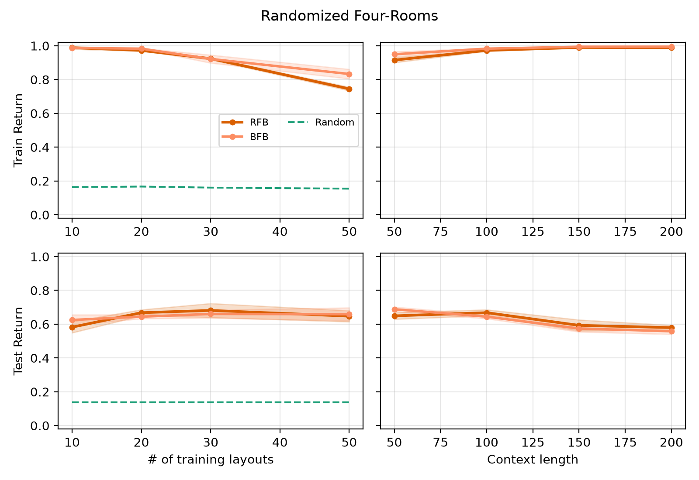
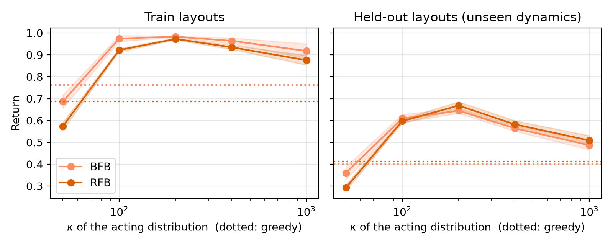
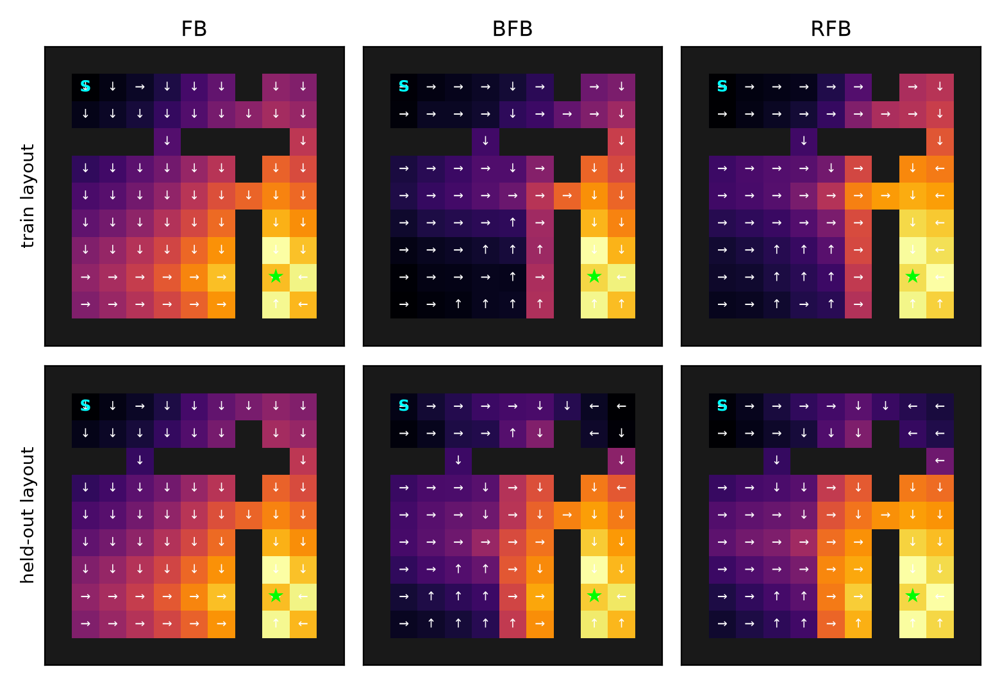
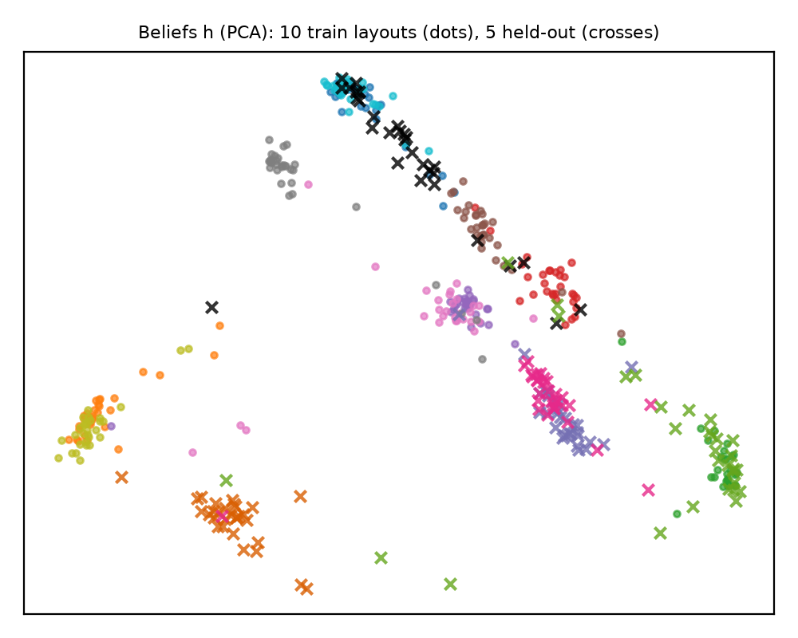

# Belief-Conditioned FB (BFB / RFB)

JAX implementation of **Belief-FB** and **Rotation-FB** from
*Zero-Shot Adaptation of Behavioral Foundation Models to Unseen Dynamics* (ICLR 2026,
[arXiv:2505.13150](https://arxiv.org/abs/2505.13150)).

> **Version 2.** This is a rewrite of the code originally released with the paper. It fixes bugs that made the
> original results hard to reproduce, makes the experimental protocol explicit and reproducible from a single command,
> and adds improvements found while re-running the experiments. Everything is listed in
> [What changed in v2](#what-changed-in-v2). The original code is kept under the git tag `v1.0-paper-original`.
> v2 currently covers the Randomized Four-Rooms experiments (Fig. 5, Fig. 6, Fig. 7, Fig. 12, Four-Rooms columns of
> Table 1).

## Installation

The project uses [uv](https://docs.astral.sh/uv/) (no conda needed):

```bash
./setup.sh
```

`setup.sh` runs `uv sync` with `http(s)_proxy` removed from the environment, so packages are always downloaded
directly from PyPI even if a proxy is exported for other tools (e.g. wandb). Prefix commands with `uv run` or activate
`.venv`. JAX is installed with CUDA 12 wheels (`jax[cuda12]`); the NVIDIA driver must support CUDA 12.

## Quick start

```bash
uv run scripts/train_fourrooms.py agent=bfb num_train_layouts=20            # Belief-FB
uv run scripts/train_fourrooms.py agent=rfb num_train_layouts=30 seed=1     # Rotation-FB
uv run scripts/train_fourrooms.py agent=fb                                  # baselines: fb | hilp | lap
```

The dataset is generated on first use (`data/fourrooms_layouts{N}_1000000.npz`, < 1 min). The pre-trained context
encoder is cached in `data/encoders/` and shared by BFB / RFB runs with the same data, context length and seed.
Metrics go to `runs/<agent>/.../metrics.jsonl` and `final.json`; set `wandb.mode=online` to also log to Weights &
Biases. All hyperparameters are in `configs/` (Hydra) and can be overridden from the command line.

### Reproducing the figures

```bash
uv run scripts/launch.py --grid layouts --gpus 0 1 --jobs-per-gpu 3    # Fig. 5 left: 10/20/30/50 layouts, BFB+RFB, 3 seeds
uv run scripts/launch.py --grid context --gpus 0 1 --jobs-per-gpu 3    # Fig. 5 right: context 50/150/200
uv run scripts/plot_fig5.py --root runs/fig5 --out figures/fig5_fourrooms.png
uv run scripts/kappa_study.py --runs runs/fig5/*/num_train_layouts20_context_len100_seed* --out figures/kappa.png
uv run scripts/visualize.py --runs <fb run> <bfb run> <rfb run> --out figures             # Fig. 7 / Fig. 12 analogues
uv run scripts/eval_checkpoint.py <run> [--online-belief] [--task-kappa 200] [--epsilon 0.1]  # re-evaluate a run
```

`launch.py` skips finished runs (and runs in progress in another launcher), so it can be re-run to resume. One run
(encoder pre-training + 300K FB updates) takes about 1 h on an RTX 3090 Ti when it has the GPU to itself.

## Results (Randomized Four-Rooms)

Return = success rate (goal reached within 100 steps). *Test* = 20 held-out layouts, i.e. dynamics never seen in
training. Mean ± std over 3 seeds; each number averages 20 layouts x 3 goals x 20 exploration contexts.



| | layouts | context | train | test (unseen dynamics) |
|---|---|---|---|---|
| Random policy | 20 | – | 0.16 | 0.14 |
| BFB | 10 | 100 | 0.99 ± 0.00 | 0.62 ± 0.03 |
| BFB | 20 | 100 | 0.98 ± 0.00 | 0.64 ± 0.01 |
| BFB | 30 | 100 | 0.92 ± 0.02 | 0.66 ± 0.02 |
| BFB | 50 | 100 | 0.83 ± 0.03 | 0.66 ± 0.04 |
| RFB | 10 | 100 | 0.99 ± 0.01 | 0.58 ± 0.03 |
| RFB | 20 | 100 | 0.97 ± 0.00 | 0.67 ± 0.02 |
| RFB | 30 | 100 | 0.92 ± 0.01 | 0.68 ± 0.04 |
| RFB | 50 | 100 | 0.75 ± 0.01 | 0.65 ± 0.03 |

The full table, including the context-length ablation, is in `figures/fig5_fourrooms.md`. Under the protocol of the
paper (greedy actions with a single belief inferred before the episode), BFB / RFB reach 0.59 / 0.47 on training
layouts and 0.24 / 0.23 on test layouts with 20 layouts. The difference comes from the two inference changes
described below.

Findings:

* **BFB and RFB generalize to unseen dynamics.** On held-out layouts they reach 0.58–0.69 vs 0.14 for a random policy.
  For reference, a vanilla FB baseline (20 layouts, one seed, same protocol) reaches 0.62 / 0.54 (train / test).
* **Online belief and stochastic task codes matter most.** Without them (greedy actions, a single belief), returns on
  held-out layouts drop to about 0.24 for both methods. Most failures were the deterministic greedy policy looping.
* **RFB vs BFB.** In this environment RFB performs on par with BFB. It is ahead by 0.02–0.03 with 20 and 30 training
  layouts and with longer contexts, behind with 10 layouts and with a 50-step context, and the differences are within
  about 1–2 standard deviations. We did not find a configuration in which RFB is consistently and significantly better
  than BFB.
* **kappa controls behaviour diversity.** Acting with z' ~ vMF(z, kappa) gives a clear optimum at kappa ≈ 200: smaller
  kappa is too random, larger kappa approaches the looping greedy policy.



Q-values and greedy policies on a training and a held-out layout (FB ignores the structure of the new layout;
BFB / RFB adapt to it), and beliefs of training (dots) and held-out (crosses) layouts:




## Method and protocol

**Environment.** 11x11 grid with an inner horizontal and an inner vertical wall at random positions, one door in each
of the four wall segments. The layout is the hidden context; observations are the (row, col) position; actions are
{up, down, left, right}; moving into a wall leaves the agent in place. Layout `i` is generated by
`bfb.envs.fourrooms.make_layout(seed=i)` (identical to the layouts used in the paper).

**Datasets (Table 4).** Training layouts are seeds `0 .. N-1`. Each dataset has 1,000,000 transitions in total,
collected by a uniform random policy from uniformly random start cells, in episodes of 100 steps:

| # layouts | episodes / layout | episode length | transitions |
|---|---|---|---|
| 10 | 1000 | 100 | 1,000,000 |
| 20 | 500 | 100 | 1,000,000 |
| 30 | 333 | 100 | 999,000 |
| 50 | 200 | 100 | 1,000,000 |

**Training.**
1. *(BFB/RFB)* The transformer encoder f_dyn is pre-trained for 30K steps (`encoder_steps`) and then frozen.
2. F and B are trained for 300K steps (`fb_steps`, not including the encoder steps). Returns are flat after 100K
   steps for 10 and 30 layouts. With 50 layouts BFB's training-layout return is still slowly increasing at 300K
   (0.77 → 0.83 between 100K and 300K), so the 50-layout points are not fully converged.

**BFB.** F(s, a, z, h) is conditioned on the belief h (standardised and projected to the sphere); B(s) is not.
**RFB.** On top of BFB:
* the paper's task prior: half of the training task vectors are sampled from vMF(h, kappa = 10) around the belief
  direction (Algorithm 2);
* *belief rotation*: during FB training the belief direction is randomly rotated, h ~ vMF(h, 100), which makes F
  smooth across neighbouring contexts.

Other sphere-geometry variants we studied are available as options: `agent.cone_kappa` maps every task into a cap
around h, `agent.geodesic_kappa` rotates h towards other contexts' beliefs, and `agent.task_kappa` rotates the goal
codes. None of them was significantly better.

**Evaluation** (`bfb/evaluation.py`). Train set: all N training layouts. Test set: 20 fixed held-out layouts
(seeds 10000-10019, checked to differ from all of the first 50 training layouts); it is the same set for every N.
For each layout, goal and exploration context:
1. *Context:* one reward-free random-exploration episode of `context_len` steps from the start cell (1, 1).
2. *Task:* one of 3 fixed goals, (2, 8), (8, 2), (8, 8), one in each room other than the start room. The task
   vector is z = B(goal).
3. *Rollout:* from (1, 1), at most 100 steps. At every step the agent:
   * re-encodes the most recent `context_len` transitions (the exploration context followed by its own
     transitions) to update its belief h (`eval.online_belief`; no learning, no rewards);
   * acts greedily w.r.t. F(s, a, z', h)ᵀz' for a task code z' ~ vMF(z, 200) (`eval.task_kappa`).
   Return = 1 if the goal is reached, else 0.

The paper's protocol (`eval.online_belief=false eval.task_kappa=null`) and returns from random start cells are
logged as well (`*_greedy_point_belief`, `*_random_start`).

## Code structure

```
bfb/
  envs/fourrooms.py   randomized four-rooms layouts + a vectorised numpy environment
  data.py             dataset generation and on-device sampling (transitions, context windows, queries)
  networks.py         F (discrete, ensemble of 2, with s / (s, [h; z]) embeddings), B, transformer f_dyn, predictor
  agent.py            FB / Belief-FB / Rotation-FB agent (encoder pre-training + FB training + inference)
  vmf.py              von Mises-Fisher sampler (Wood, 1994; tabulated inverse CDF) + Householder rotation
  baselines.py        HILP and Laplacian baselines (discrete actions)
  evaluation.py       zero-shot evaluation protocol
  diagnostics.py      layout identification accuracy of the belief h
configs/              Hydra configs (train.yaml, agent/{fb,bfb,rfb,hilp,lap}.yaml)
scripts/              train_fourrooms.py, launch.py, plot_fig5.py, kappa_study.py, visualize.py, eval_checkpoint.py
```

## What changed in v2

Bugs in the original release:

* **Dataset size.** Table 4 lists 250 / 150 episodes per layout for 30 / 50 layouts, i.e. only 750K transitions.
  v2 fixes the total budget at 1M and derives the episodes per layout (table above).
* **Test layouts changed with N.** The test layouts were seeds `N+40 .. N+59` (`N+100 .. N+109` in the notebooks),
  so every point on the x-axis of Fig. 5 used a different test set. v2 uses one fixed set.
* **Start position.** `main_dynamics_discrete.py` evaluated from random start cells, although Appendix D says (1, 1).
  This makes the task much easier (compare `*_random_start`). v2 starts from (1, 1).
* **Training steps.** The released configs used 200K total iterations, of which the first 80K only trained the
  encoder. v2 separates encoder pre-training from the FB steps.
* **Target policy.** The discrete FB target used a softmax with temperature 350 over Q, close to the uniform policy,
  so F learned the successor measure of a random policy. v2 uses the greedy policy of Eq. (10).
* **Rotation-FB sampler.** The vMF sampler lacked the rejection step of Wood's algorithm and reused the same PRNG key
  for z, the mixing mask and the belief noise. It also required `output_dim == z_dim` without checking it.
* **Episode boundaries** were never stored, and actions were fed to f_dyn as raw integers.
* The belief was sampled with a fixed PRNG key at test time; v2 uses its mean.

Changes to the method (all configurable):

* **Forward-map preprocessors** (`agent.f_preprocessor_dims`): separate embeddings of s and (s, [h; z]) as described in
  Appendix E.1.2. The original discrete code fed the 2-D position concatenated with the 100-D z to one MLP, and
  without the preprocessors FB does not solve even a single fixed layout. Positions are one-hot encoded per row and
  column (`agent.obs_encoding`).
* **FB loss** follows Meta's reference implementation (`metamotivo/fb`): Eq. (13), mean over the two target networks,
  B projected to the sphere, orthonormality loss. The TD-LSIF variant of
  [onestep-fb](https://github.com/chongyi-zheng/onestep-fb) is available with `agent.fb_loss=lsif`.
* **Discount 0.95 and learning rate 3e-4** (Table 5: 0.99 and 1e-4). With γ = 0.99 the successor measure is
  dominated by its ~1/(1-γ) state-independent mass, and greedy goal-reaching policies were barely better than random
  even with the true layout given to F.
* **Encoder objective** (`agent.encoder.objective`, `agent.encoder.query`). Algorithm 1 predicts s' for the
  transitions of the context itself. In Four-Rooms the only layout-dependent part of the dynamics is whether a move is
  blocked by a wall; next-state regression gave a chance-level belief. v2 predicts, from h, whether held-out
  transitions of the same layout are blocked; the belief then identifies training layouts 75% of the time from a
  single 100-step exploration episode (chance: 5%). The KL prior on h is off by default (it collapses the belief).
* **Inference:** online belief update and vMF task codes at test time (see Evaluation).
* **RFB:** belief rotation (see Method).
* **Speed:** sampling and updates run on the GPU inside `jax.lax.scan`, the vMF sampler uses a tabulated inverse CDF,
  and beliefs of the frozen encoder are pre-computed for 512 contexts per training layout.

## Citation

```bibtex
@inproceedings{bobrin2026zeroshot,
  title     = {Zero-Shot Adaptation of Behavioral Foundation Models to Unseen Dynamics},
  author    = {Bobrin, Maksim and Zisman, Ilya and Nikulin, Alexander and Kurenkov, Vladislav and Dylov, Dmitry},
  booktitle = {International Conference on Learning Representations},
  year      = {2026}
}
```
