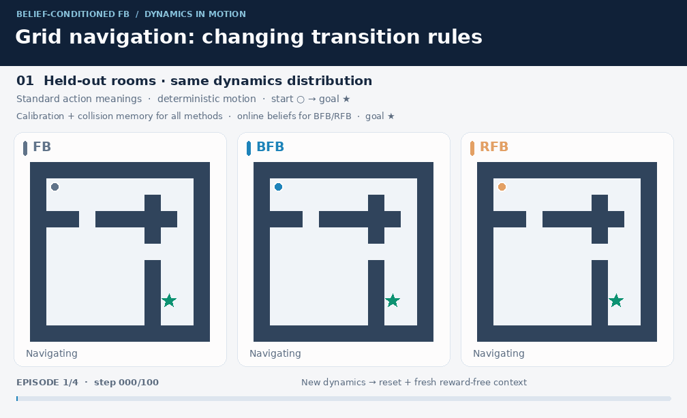
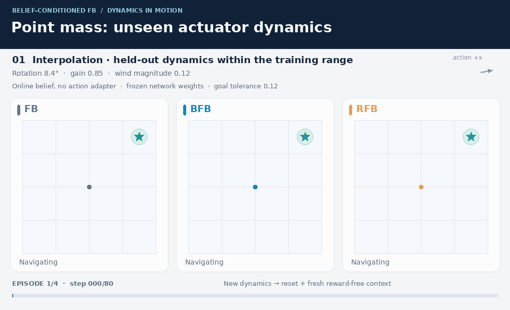
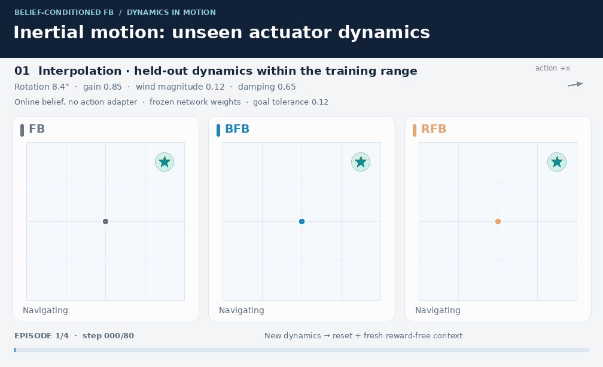
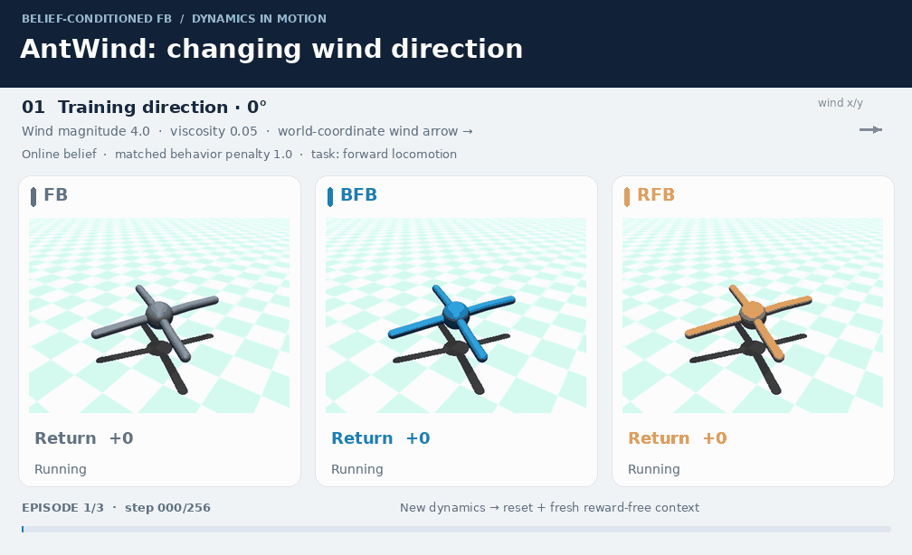

# Belief-conditioned Forward–Backward representations

An audited JAX implementation of FB, Belief-FB (BFB), and Rotation-FB (RFB), based on
[Zero-Shot Adaptation of Behavioral Foundation Models to Unseen Dynamics](https://arxiv.org/abs/2505.13150).

This repository includes reproducible experiments, explicit dynamics shifts, per-trial results, and inference
extensions. **It is a research reproduction and extension, not a claim that every paper result has been reproduced.**
The [reproduction report](docs/reproduction.md) distinguishes the paper, inherited v2 checkpoints, fresh runs,
and modifications. The [benchmark definitions](docs/benchmarks.md) specify what each score measures.

## Dynamics in motion

Actual checkpoint rollouts, with **FB / BFB / RFB side by side**. Every scene changes the dynamics **between
episodes**, resets the environment, and supplies a fresh reward-free context. These clips do not demonstrate
mid-episode dynamics switching. Examples use seed-0 checkpoints and fixed first evaluation trials, including
failures; aggregate conclusions come from the three-seed results below.

**Grid navigation — held-out rooms → unseen action remapping → stochastic actions → random obstacles.**
All three methods use online beliefs where available, action calibration, and collision memory.



**Continuous point mass — interpolation → excluded rotation quadrant → affine adaptation → weaker actuation.**
The third scene fits an affine dynamics map from context; the other scenes use the learned policies directly.
This is the lightweight diagnostic environment, not the paper's MuJoCo maze.



**Inertial motion — the same shifts with velocity and momentum.**
The small arrows show velocity. These agents were trained with inertia; this does not claim transfer from
non-inertial training to inertial dynamics.



**AntWind — a training wind direction → two excluded wind directions.**
All methods use the same behavior penalty of 1.0 and reward-free contexts from the released expert data.
The arrow shows wind in world x/y coordinates; returns are cumulative for the displayed episode.



[Animation settings, trajectory records, and regeneration](docs/animations.md).

## Results and evidence


- [Measured results and limitations](docs/reproduction.md)
- [All seed-level aggregate scores](results/summary.csv) and [paired comparisons](results/paired_comparisons.csv)
- [Individual seed scores](results/seed_scores.csv)
- [Layout-diversity and context-length sweeps](results/grid_sweeps.csv)
- [Compressed full configurations, provenance, and trial arrays](results/evidence/experiments.jsonl.gz)
- [Dataset audit](results/data_audit.json)
- [Evidence format and regeneration](results/README.md)

The main findings are that inference settings strongly affect Four-Rooms success, unseen action remapping breaks
unmodified agents, and adaptation to unseen continuous dynamics is substantially harder than interpolation.
Observation-only action calibration and collision memory improve grid transfer. A fitted affine action adapter
helps on continuous rotation shifts but is explicitly restricted to the corresponding dynamics family.

## Install

Python 3.10–3.12 and [uv](https://docs.astral.sh/uv/) are required. Experiments use JAX/CUDA 12; two RTX 3090 Ti GPUs
were used for the recorded runs.

```bash
uv sync --locked                      # core experiments and development tools
uv sync --locked --extra mujoco        # also install MuJoCo/Gymnasium for AntWind
JAX_PLATFORMS=cpu uv run pytest -q
uv run ruff check bfb scripts tests
```

`setup.sh` is a convenience wrapper around `uv sync`. GPU workers disable JAX preallocation and use independent
seeds; no distributed-training installation is needed. Set `CUDA_VISIBLE_DEVICES=0` for a standalone run.

## Train

```bash
# Four-Rooms: full v2 reference settings, or a smaller declared compute budget.
uv run scripts/train_fourrooms.py agent=bfb num_train_layouts=30 out_dir=runs/my_grid_bfb
uv run scripts/train_fourrooms.py --config-name compact_grid agent=rfb

# Continuous diagnostics: hidden actuator rotation/wind, with optional inertia.
uv run scripts/train_continuous.py agent=bfb family=pointmass
uv run scripts/train_continuous.py agent=rfb family=inertial

# Three seeds, FB/BFB/RFB, both diagnostic families, bounded GPU concurrency.
uv run scripts/run_suite.py --suite continuous --gpus 0 1 --jobs-per-gpu 2

# Official AntWind data and the paper's XML/wind settings.
uv run --with gdown scripts/fetch_antwind.py
uv run --extra mujoco scripts/train_continuous.py --config-name antwind agent=bfb
# Fair comparison with the stronger behavior-cloning regularizer used in the report.
uv run --extra mujoco scripts/run_suite.py --suite antwind --gpus 0 1 \
  --root runs/antwind_bc agent.bc_coef=1.0
```

Training writes resolved configs, provenance, losses, inference checkpoints, and `final.json`. Finalized runs are
protected from accidental overwrites. `run_suite.py` skips completed runs, uses process-safe locks, records commands,
and exits unsuccessfully if a child fails. Continuous training resumes interrupted runs from `training_state.pkl`
(including optimizer and target networks); an inference-only `checkpoint.pkl` is not a training resume file.
Use a different `out_dir`/`--root` when changing settings. `--dry-run` previews suite commands.

## Evaluate

```bash
# Four protocols separate static/online beliefs from deterministic/sampled actions.
uv run scripts/benchmark_grid.py --run runs/my_grid_bfb \
  --suites iid slip remap obstacles \
  --protocols greedy_static greedy_online sampled_static sampled_online

# Extensions use only observed transitions, never the simulator's hidden layout/action map.
uv run scripts/benchmark_grid.py --run runs/my_grid_bfb \
  --protocols calibrated_online guarded_online --out results/my_grid_adapted

# Random and full-information shortest-path controls.
uv run scripts/benchmark_grid.py --out results/my_controls

# Continuous action-coordinate adapter (not applicable to AntWind).
uv run scripts/benchmark_continuous.py --run runs/continuous/pointmass/bfb/seed0 --adapter

# Verify datasets and regenerate tables/figure/evidence from completed runs.
uv run scripts/audit_data.py
JAX_PLATFORMS=cpu uv run scripts/summarize_results.py
uv run scripts/write_report.py

# A fresh checkout can regenerate published tables using the included evidence.
JAX_PLATFORMS=cpu uv run scripts/summarize_results.py \
  --from-evidence results/evidence/experiments.jsonl.gz
```

Evaluation writes every success/return and episode length, not just averages. Training seeds are the units for
reported standard deviations. The default test seed is fixed across algorithms; validation uses separate dynamics.
Existing evaluation files are protected from overwrites: select another output directory for reruns.

## Navigate

| Location | Purpose |
|---|---|
| `bfb/agent.py`, `bfb/continuous.py` | Discrete and continuous FB/BFB/RFB training and inference |
| `bfb/networks.py`, `bfb/vmf.py` | Networks and tested directional sampling |
| `bfb/data.py`, `bfb/antwind.py` | Offline sampling, official AntWind loading/evaluation |
| `bfb/envs/` | Four-Rooms, declared grid shifts, continuous diagnostics, AntWind |
| `bfb/adaptation.py`, `bfb/affine_adaptation.py` | Observation-only inference extensions |
| `bfb/evaluation.py`, `bfb/continuous_evaluation.py` | Paired evaluation protocols |
| `configs/` | Reference, compact, continuous, and AntWind settings |
| `scripts/train_*`, `scripts/run_suite.py` | Training and multi-GPU scheduling |
| `scripts/benchmark_*`, `scripts/summarize_results.py` | Evaluation and evidence aggregation |
| `tests/` | Numerical, environment, protocol, and checkpoint regression tests |
| `docs/`, `results/` | Methods, limitations, measured evidence |

The original release remains available at Git tag `v1.0-paper-original`. Legacy plotting and Fig. 5 sweep scripts
are retained, but the current evidence is produced by the benchmark and summary scripts above.

## Citation

```bibtex
@inproceedings{bobrin2026zeroshot,
  title={Zero-Shot Adaptation of Behavioral Foundation Models to Unseen Dynamics},
  author={Bobrin, Maksim and Zisman, Ilya and Nikulin, Alexander and Kurenkov, Vladislav and Dylov, Dmitry},
  booktitle={International Conference on Learning Representations},
  year={2026}
}
```
