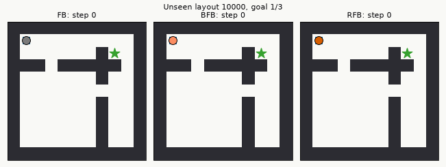

<div align="center">

# Belief-Conditioned Forward-Backward Representations

**Zero-Shot Adaptation of Behavioral Foundation Models to Unseen Dynamics** (ICLR 2026)

[](https://arxiv.org/abs/2505.13150)
[](https://belief-fb.dunnolab.ai/)


[](LICENSE.txt)



<sub>Zero-shot rollouts on <b>layouts never seen during training</b> (the first two held-out layouts, fixed seed, not
selected for success). Blue square = start, green star = goal. Each agent first explores the new layout for 100
reward-free steps, then is asked to reach each goal.</sub>

</div>

---

## TL;DR

Forward-Backward (FB) representations give zero-shot policies for any reward, but a single FB model trained on data
from many environments with different dynamics averages over them and fails in each. This repository contains:

- **Belief-FB (BFB):** a permutation-invariant transformer infers a belief **h** about the hidden dynamics from a short
  reward-free trajectory, and the forward map is conditioned on it: F(s, a, z, h)ᵀB(s').
- **Rotation-FB (RFB):** BFB plus hypersphere geometry around the belief (vMF task prior around **h**, random rotations
  of **h** during training).
- A clean, fast JAX implementation of Randomized Four-Rooms with FB / BFB / RFB and the HILP / Laplacian baselines,
  with the full Fig. 5 / Fig. 6 pipeline reproducible from a few commands.

> **This is version 2 of the code.** It fixes several bugs of the original release and changes parts of the method
> and protocol (see [What changed in v2](#what-changed-in-v2)). The original code is available under the git tag
> [`v1.0-paper-original`](../../tree/v1.0-paper-original). v2 covers the Randomized Four-Rooms experiments.

## Results at a glance

Randomized Four-Rooms; **test = 20 held-out layouts (unseen dynamics)**; return = success rate; mean ± std over 3
seeds, each averaging 20 layouts x 3 goals x 20 exploration contexts.

| Training layouts | 10 | 20 | 30 | 50 |
|:--|:--:|:--:|:--:|:--:|
| Random policy | 0.14 | 0.14 | 0.14 | 0.14 |
| **BFB** (train / test) | 0.99 / **0.62** ± .03 | 0.98 / **0.64** ± .01 | 0.92 / **0.66** ± .02 | 0.83 / **0.66** ± .04 |
| **RFB** (train / test) | 0.99 / **0.58** ± .03 | 0.97 / **0.67** ± .02 | 0.92 / **0.68** ± .04 | 0.75 / **0.65** ± .03 |

- ✅ **Both BFB and RFB generalize to unseen dynamics**: 0.58–0.69 on held-out layouts vs 0.14 for a random policy.
  For reference, vanilla FB (one seed, same protocol) reaches 0.54.
- ⚖️ **RFB vs BFB:** on par in this environment. RFB is ahead with 20–30 training layouts and with longer contexts,
  behind with 10 layouts; the differences are within about 1–2 standard deviations.
- 🔁 **Inference matters.** Updating the belief online and acting with task codes sampled on the sphere raise the
  held-out return from ≈ 0.24 (greedy actions with a single belief, the protocol of the paper) to ≈ 0.65.

<table>
<tr>
<td width="55%"></td>
<td width="45%"></td>
</tr>
<tr>
<td><sub><b>Fig. 5.</b> Train / test return vs number of training layouts and context length.</sub></td>
<td><sub><b>Fig. 12 analogue.</b> Values and greedy actions on a training and a held-out layout. FB's map on the
held-out layout is nearly the same as on the training layout (it ignores the new walls); BFB and RFB adapt.</sub></td>
</tr>
<tr>
<td></td>
<td></td>
</tr>
<tr>
<td><sub><b>Fig. 6 analogue.</b> κ of the acting distribution z' ~ vMF(z, κ) controls behaviour diversity. Small κ
is too random, large κ approaches the greedy policy, which tends to loop (dotted).</sub></td>
<td><sub><b>Fig. 7 analogue.</b> PCA of beliefs h: training layouts (dots) form separate clusters, and held-out
layouts (crosses) fall in their own regions or between them.</sub></td>
</tr>
</table>

## Installation

```bash
git clone https://github.com/maxsbob/BeliefConditionedFB && cd BeliefConditionedFB
./setup.sh          # = uv sync, with http(s)_proxy removed so packages come directly from PyPI
```

Requires [uv](https://docs.astral.sh/uv/) and an NVIDIA driver supporting CUDA 12 (JAX is installed as
`jax[cuda12]`). Run commands with `uv run ...` or activate `.venv`.

## Quick start

```bash
uv run scripts/train_fourrooms.py agent=bfb num_train_layouts=20     # Belief-FB
uv run scripts/train_fourrooms.py agent=rfb num_train_layouts=20     # Rotation-FB
uv run scripts/train_fourrooms.py agent=fb                           # baselines: fb | hilp | lap
```

- The dataset is generated on first use (< 1 min). The pre-trained context encoder is cached in `data/encoders/` and
  shared by BFB / RFB runs with the same settings.
- Metrics are written to `runs/.../metrics.jsonl` and `final.json`; add `wandb.mode=online` for Weights & Biases.
- Any hyperparameter can be overridden from the command line (Hydra), e.g. `agent.kappa=50 context_len=150`.

## Reproducing the figures

```bash
uv run scripts/launch.py --grid layouts --gpus 0 1 --jobs-per-gpu 3   # Fig. 5 (left), BFB + RFB, 3 seeds
uv run scripts/launch.py --grid context --gpus 0 1 --jobs-per-gpu 3   # Fig. 5 (right)
uv run scripts/plot_fig5.py --root runs/fig5 --out figures/fig5_fourrooms.png
uv run scripts/kappa_study.py --runs runs/fig5/*/num_train_layouts20_context_len100_seed* --out figures/kappa.png
uv run scripts/visualize.py --runs <fb run> <bfb run> <rfb run> --out figures          # Q maps, beliefs
uv run scripts/make_gif.py  --runs <fb run> <bfb run> <rfb run> --out figures/rollouts.gif
```

`launch.py` runs a grid a few jobs per GPU, skips finished runs and runs in progress elsewhere, and can be re-run to
resume. One run (30K encoder + 300K FB steps) takes about 1 h on an RTX 3090 Ti; `scripts/eval_checkpoint.py`
re-evaluates saved runs with other inference options.

## Method

| Component | What it does | Config |
|:--|:--|:--|
| Belief encoder f_dyn | Permutation-invariant transformer over (s, a, s') transitions → belief h. Pre-trained to predict whether held-out transitions of the same layout hit a wall, then frozen. | `agent.encoder.*` |
| Belief-FB | F(s, a, z, h) with separate embeddings of s and (s, [h; z]); B(s) shared across dynamics. Meta's FB loss ([metamotivo](https://github.com/facebookresearch/metamotivo/tree/main/metamotivo/fb)). | `agent=bfb` |
| Rotation-FB | Half of the training task vectors z ~ vMF(h, κ=10) (Algorithm 2); during training the belief direction is rotated, h ~ vMF(h, 100). | `agent=rfb`, `agent.kappa`, `agent.belief_kappa` |
| Online belief | At test time the belief is re-encoded from the most recent transitions, including the agent's own (no learning, no rewards). | `eval.online_belief` |
| Sphere-sampled acting | Act greedily w.r.t. F(s, a, z', h)ᵀz' with z' ~ vMF(z, κ=200) instead of z itself. | `eval.task_kappa` |

<details>
<summary><b>Experimental protocol</b></summary>

**Environment.** 11x11 grid; an inner horizontal and an inner vertical wall at random positions with one door per
wall segment. The layout is the hidden context; observations are (row, col); actions are {up, down, left, right};
moving into a wall leaves the agent in place. Layout `i` = `bfb.envs.fourrooms.make_layout(seed=i)` (identical to the
paper's layouts).

**Datasets.** Training layouts are seeds `0 .. N-1`. Each dataset has 1M transitions collected by a uniform random
policy from random start cells in episodes of 100 steps: 1000 / 500 / 333 / 200 episodes per layout for
N = 10 / 20 / 30 / 50 (999K transitions for N = 30).

**Training.** Encoder pre-training for 30K steps, then 300K FB steps (batch 1024, Adam 3e-4, γ = 0.95, z and h in
100 dimensions). Returns are flat after 100K steps for 10 and 30 layouts; with 50 layouts BFB's training-layout return
still slowly increases at 300K.

**Evaluation.** Train set: the N training layouts. Test set: 20 fixed held-out layouts (seeds 10000-10019, checked to
differ from all of the first 50 training layouts), the same for every N. For each layout, goal and exploration
context: a reward-free random-exploration episode of `context_len` steps from (1, 1) gives the initial belief; then
the agent starts at (1, 1) with z = B(goal) and acts for at most 100 steps (online belief, sphere-sampled acting).
Return = 1 if the goal is reached. The 3 goals are (2, 8), (8, 2), (8, 8), one in each room other than the start room.
The paper's protocol (greedy actions, single belief) and random-start returns are logged as well.

</details>

<details>
<summary><b>What changed in v2</b></summary>

**Bugs fixed in the original release**

- *Dataset size:* Table 4 gives 250 / 150 episodes per layout for 30 / 50 layouts (750K transitions). v2 keeps 1M.
- *Test set changed with N:* the held-out layouts were seeds `N+40 .. N+59` (`N+100 .. N+109` in the notebooks). v2
  uses one fixed set.
- *Start position:* `main_dynamics_discrete.py` evaluated from random start cells instead of (1, 1).
- *Training steps:* the released configs ran 200K iterations in total, including 80K encoder-only warm-up steps. v2
  separates encoder pre-training from FB training.
- *Target policy:* a softmax with temperature 350 over Q (close to uniform) instead of the greedy policy.
- *Rotation-FB:* the vMF sampler lacked the rejection step and reused PRNG keys.
- Episode boundaries were not stored; raw integer actions were fed to the encoder; beliefs were sampled with a fixed
  key at test time.

**Method and protocol changes**

- Forward-map preprocessors (Appendix E.1.2; missing in the original discrete code) and one-hot positions. Without
  them FB does not solve even a single layout.
- Discount 0.95 and learning rate 3e-4 (Table 5: 0.99 and 1e-4). With γ = 0.99 greedy goal-reaching policies were
  barely better than random, even when F was given the true layout.
- Encoder objective: classify wall collisions of held-out transitions instead of regressing s' of the context
  transitions (which gave a chance-level belief); no KL prior on h.
- Online belief and sphere-sampled acting at test time.
- RFB: belief rotation in addition to the paper's vMF task prior. Further variants (`agent.cone_kappa`,
  `agent.geodesic_kappa`, `agent.task_kappa`) are available but were not better.
- Speed: on-device sampling with `jax.lax.scan`, a tabulated vMF sampler, cached encoders.

</details>

## Repository structure

```
bfb/
├── envs/fourrooms.py   randomized four-rooms layouts + vectorised numpy environment
├── data.py             dataset generation, on-device sampling of transitions / contexts / queries
├── networks.py         F, B, transformer belief encoder, outcome predictor
├── agent.py            FB / BFB / RFB: encoder pre-training, FB training, inference
├── vmf.py              von Mises-Fisher sampling + Householder rotation
├── baselines.py        HILP and Laplacian baselines
├── evaluation.py       zero-shot evaluation protocol
└── diagnostics.py      layout identification accuracy of the belief
configs/                Hydra configs: train.yaml, agent/{fb,bfb,rfb,hilp,lap}.yaml
scripts/                train_fourrooms · launch · plot_fig5 · kappa_study · visualize · make_gif · eval_checkpoint
```

## Citation

```bibtex
@inproceedings{bobrin2026zeroshot,
  title     = {Zero-Shot Adaptation of Behavioral Foundation Models to Unseen Dynamics},
  author    = {Bobrin, Maksim and Zisman, Ilya and Nikulin, Alexander and Kurenkov, Vladislav and Dylov, Dmitry},
  booktitle = {International Conference on Learning Representations},
  year      = {2026}
}
```
