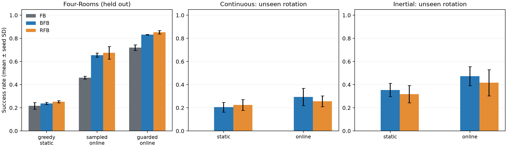
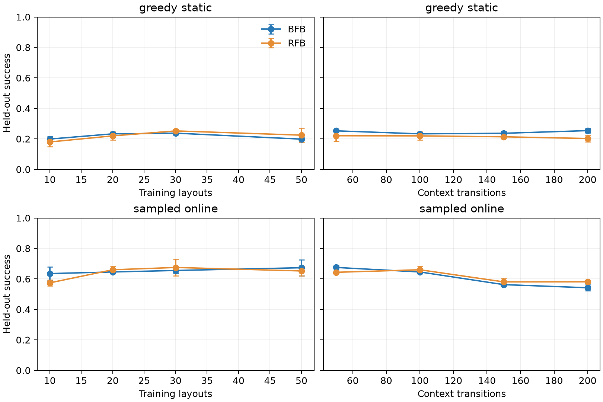

# Reproduction and extension report — 3 November 2026

**The full set of paper claims is not reproduced.** Belief conditioning helps on the declared continuous rotation
shifts and the revised grid protocol. The paper-style fixed-belief grid scores are lower than the reported means;
RFB is not uniformly better than BFB; and a matched, strongly regularized FB baseline wins on AntWind.
The repo now contains tested implementations and the positive and negative evidence needed to inspect those findings.

## What was actually run

- 35 fresh research training runs: 3 full-size grid FB baselines; 18 continuous diagnostics (2 families × 3 methods ×
  3 seeds); 3 exploratory AntWind runs; 9 matched AntWind BC runs; and 2 compact-grid pilots.
- Independent re-evaluation of all 42 inherited v2 BFB/RFB grid checkpoints, including the layout-count and
  context-length sweeps. These are **re-evaluations**, not newly trained models. Their historical tuning used these
  test layouts, so the new evaluation seed does not make the layouts an untouched research holdout.
- Paired grid protocols, shuffled/zero-belief controls, random policies, full-map oracles, action-symmetry adapters,
  and affine adapters. Raw trials, checkpoint/configuration hashes, and provenance are in the evidence archive.
- Dataset audit of all five cached grid datasets and all 20 official AntWind files. Numerical regression tests and
  CLI smoke runs are separate from research results and are not counted as successful reproductions.

Except where explicitly marked as a pilot, tables show mean ± **sample SD over three training seeds**. Success rates
are fractions; AntWind uses raw return. [All scores](../results/summary.csv),
[paired bootstrap comparisons](../results/paired_comparisons.csv), and
[compressed trial evidence](../results/evidence/experiments.jsonl.gz) are machine-readable.

## Four-Rooms and distribution shifts

These evaluations use 30 training layouts, 20 held-out layouts, three goals, and 20 contexts per layout, with 100
exploration transitions and a 100-step control horizon. The learned weights remain fixed during evaluation.

| Protocol / shift | FB | BFB | RFB |
| --- | --- | --- | --- |
| Held-out rooms; greedy, static belief | 0.217 ± 0.029 | 0.238 ± 0.010 | 0.252 ± 0.010 |
| Held-out rooms; sampled, online belief | 0.461 ± 0.012 | 0.655 ± 0.018 | 0.675 ± 0.055 |
| Held-out rooms; calibrated + collision memory | 0.721 ± 0.024 | 0.832 ± 0.002 | 0.853 ± 0.015 |
| Unseen action remap; sampled, online | 0.000 ± 0.000 | 0.001 ± 0.001 | 0.000 ± 0.000 |
| Unseen action remap; calibrated + memory | 0.721 ± 0.028 | 0.840 ± 0.007 | 0.856 ± 0.016 |
| Random obstacles; calibrated + memory | 0.742 ± 0.004 | 0.754 ± 0.018 | 0.764 ± 0.004 |
| Action slip; sampled, online | 0.685 ± 0.024 | 0.722 ± 0.024 | 0.731 ± 0.006 |

The uniform random policy scores about 0.143 on held-out rooms; the full-map oracle solves all trials. Static greedy
inference falls short of the paper's quoted BFB/RFB means of 0.40/0.61. The much higher sampled-online scores use
the changed v2 protocol and must not be presented as strict reproduction. Training also differs from the paper.

An unseen action permutation breaks the unmodified agents. Inferring the permutation from observed movements,
then avoiding repeatedly observed self-loops, substantially improves transfer. The identical adapters are also
evaluated with FB. Neither adapter reads the grid or hidden action map. Collision memory assumes repeatable
transitions; its benefit is smaller or can disappear with action slip.

## Dataset diversity and context length

The full [sweep table](../results/grid_sweeps.csv) contains three seeds per setting. Under sampled-online inference,
increasing layout diversity gives a modest, noisy gain that saturates. Increasing context length is **not
monotonically beneficial** in this implementation; 150/200-step contexts often score worse than 50/100-step ones.
Long training contexts span multiple random-reset episodes, while evaluation contexts are contiguous exploration;
that distribution mismatch is a plausible contributor, not a demonstrated causal explanation.

## Continuous diagnostics

These are new lightweight continuous-control benchmarks, **not the paper's MuJoCo PointMass maze**. The IID split
interpolates among training dynamics; the rotation split holds out an actuator-rotation quadrant; the gain split
reduces actuation below the training range. Inertia adds a second dynamics family. All use 100K FB updates and
reward-free random-action data. Policies are evaluated on four goal tasks that are specified only at inference.

| Dynamics / split (online beliefs) | FB | BFB | RFB |
| --- | --- | --- | --- |
| pointmass / iid | 0.547 ± 0.056 | 0.913 ± 0.046 | 0.852 ± 0.050 |
| pointmass / rotation | 0.000 ± 0.000 | 0.294 ± 0.074 | 0.257 ± 0.046 |
| pointmass / gain | 0.547 ± 0.068 | 0.765 ± 0.065 | 0.706 ± 0.033 |
| inertial / iid | 0.526 ± 0.063 | 0.604 ± 0.120 | 0.680 ± 0.191 |
| inertial / rotation | 0.000 ± 0.000 | 0.473 ± 0.082 | 0.417 ± 0.113 |
| inertial / gain | 0.495 ± 0.077 | 0.499 ± 0.133 | 0.555 ± 0.094 |

Belief conditioning preserves useful behavior on rotations where FB fails. Transfer is nevertheless incomplete,
and gain extrapolation is not uniformly solved. RFB does not consistently improve upon BFB.

| Held-out rotation; affine adapter | FB | BFB | RFB |
| --- | --- | --- | --- |
| pointmass | 0.000 ± 0.000 | 0.866 ± 0.073 | 0.906 ± 0.001 |
| inertial | 0.000 ± 0.000 | 0.721 ± 0.209 | 0.542 ± 0.292 |

The affine extension estimates a transition map from the reward-free context and expresses actions in a reference
frame fitted from training data. It performs **closed-form test-time system identification**, so these are extension
results, not evidence for the paper's no-test-time-fitting protocol. It assumes observed state, affine dynamics,
and a known integration step. It helps rotation transfer, but is not a general solution to low gain, clipping,
stochasticity, or nonlinear robot dynamics. It is not applied to AntWind.

## AntWind: important negative result

This uses the released data, the paper repository's Ant XML, and its wind magnitude/viscosity. Training IDs are
0–15 and test IDs are 16–19. The context consists of reward-free slices of the released expert trajectories;
network normalization and reward labels for task inference use training data only. The horizon is 256 steps.

| Actor regularizer / protocol | FB | BFB | RFB |
| --- | --- | --- | --- |
| Weak BC (0.03), static belief; exploratory | 61.7 (1 seed) | 259.5 (1 seed) | 169.3 (1 seed) |
| BC 1.0, static belief | 1003.7 ± 78.1 | 601.6 ± 141.4 | 600.3 ± 137.9 |
| BC 1.0, online belief | 1003.7 ± 78.1 | 716.0 ± 40.7 | 735.9 ± 87.6 |
| BC 1.0, shuffled belief | 1003.7 ± 78.1 | 546.6 ± 43.0 | 567.0 ± 197.5 |

The initial weakly regularized runs did not approach the paper's BFB/RFB returns (roughly 550/640). Increasing the
offline behavior penalty restored high returns, but **FB with the same penalty is better**. Thus the strong
regularized BFB/RFB returns do not reproduce the paper's algorithm ranking. Expert behavior in the offline data
is a major confound: a forward-locomotion score alone does not establish arbitrary-task zero-shot competence.
Shuffled-belief results are reported rather than omitted.

Uniform random actions score about 97 on held-out winds; zero actions score about 281. Baseline action definitions
matter. The main paper, appendix, and released notebooks also differ in their stated data counts/splits; this
implementation explicitly fixes 16 training and 4 test winds, and records the actual 819,200 training transitions.

## Efficiency and a failed small-model shortcut

| Preset | FB parameters | Batch | Updates/s | Transitions/s |
| --- | --- | --- | --- | --- |
| Reference | 6,496,900 | 1024 | 300 | 307572 |
| Compact | 402,720 | 256 | 2161 | 553203 |

These are median steady-state rates over three timed blocks of 1,000 updates on one RTX 3090 Ti, after compilation
and belief-bank construction. The presets have different batch sizes; these rates are not full-run wall times or
an equal-quality comparison. [Full timing evidence](../results/throughput.json) includes each measurement.

| Preset | Sampled + online | Calibrated + memory |
| --- | --- | --- |
| BFB compact | 0.352 (1 seed) | 0.614 (1 seed) |
| RFB compact | 0.385 (1 seed) | 0.662 (1 seed) |

The compact preset is faster and smaller but loses substantial grid performance at its 100K-update/8K-encoder
budget. It is useful for development; the reference settings remain the quality baseline. The compact pilot is
not promoted as a successful reproduction. Frozen belief banks, on-device sampling, fused update loops, cached
encoders/compilation, and bounded multi-GPU workers make the broader suite practical.

## Limits and interpretation

- Original MuJoCo randomized PointMass and OGBench Scene/friction experiments were not reproduced. The continuous
  diagnostics are explicitly different tasks. No scores are invented or substituted for those missing experiments.
- The fresh main comparisons use three seeds, not the paper's five. HILP/LAP remain available and were smoke-tested;
  their full multi-benchmark claims were not freshly replicated.
- The grid RFB reference includes belief perturbation in addition to the vMF task prior. Its gains cannot be
  attributed solely to nonoverlapping policy clusters. With κ=10 in 100 dimensions the directional bias is weak.
- Gaussian encoder outputs are embeddings, not demonstrated calibrated posteriors. High reconstruction accuracy
  alone does not guarantee useful extrapolation or control.
- The observation-only grid adapters and the affine system-identification extension are separate contributions,
  not silent changes to the paper's evaluation. Structured priors help, and also restrict the scope of the claims.
- Continuous success means reaching a goal at least once within the horizon; the archived horizon-end distances
  are not used in the comparisons. No checkpoint is selected by maximizing test return.

See [benchmark definitions](benchmarks.md) for exact information budgets and [implementation notes](methods.md)
for corrections, checkpoint semantics, and the continuous pilot configuration compatibility note.

Sources: [paper, arXiv v2](https://arxiv.org/abs/2505.13150v2),
[official repository](https://github.com/maxsbob/BeliefConditionedFB), and local tag `v1.0-paper-original`.
